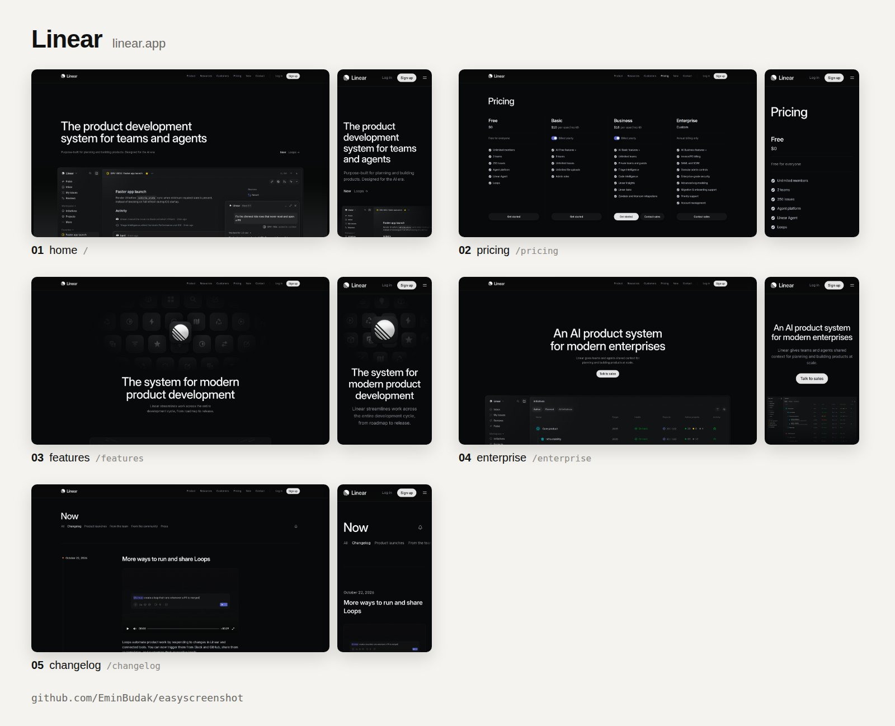
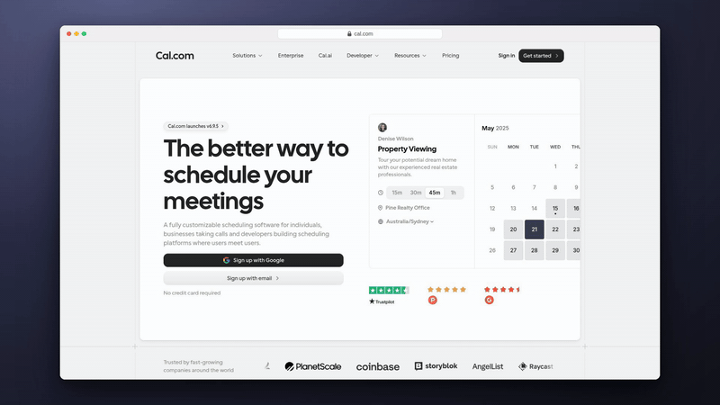

# easyscreenshotkit

Give it a website. It picks the pages worth showing, hides the cookie banners and chat bubbles, and saves desktop, phone and full-page screenshots your coding agent can use. It can also [record a demo](#record-a-demo) of the site.

```bash
npx easyscreenshotkit@latest linear.app
```



A launch video, a Product Hunt gallery, a pitch deck or a README needs the product's real screens. Taking them by hand means opening each page, closing the cookie banner, waiting for the pictures, scrolling down and doing it all again on a phone, and an agent asked to do it either guesses the pages or draws the interface itself. easyscreenshotkit reads the site's own menu, picks the pages a visitor would look at first (pricing, features, how it works), and saves each one clean, with a manifest that tells your agent what is in every file.

## What you get

```
easyscreenshotkit-linear.app/
  SCREENSHOTS.md          every page: why it was picked, its files, the headings on its first screen
  manifest.json           the same, for scripts
  sheet.png               all pages on one picture, like the one above
  01-home-desktop.png     the first screen at 2x, 3200x1800
  01-home-mobile.png      the first screen on a phone, 1080x1920
  01-home-full.png        the whole page, 1600 wide
  02-pricing-desktop.png  and the same for every other page it picked
```

- Pages are picked from the home page's own menu, its big buttons and its footer, with the sitemap as a fallback. Each one says why it was picked, for example `menu link "Pricing"`.
- Sign-in pages, legal pages, careers, single blog posts and pages in another language are left out, and so is anything the site's robots.txt asks crawlers to stay out of. A page that only redirects to a sign-in page or to the home page, a bot check, and a second address for a page already taken are dropped too. The pages it left out are listed with the reason.
- Cookie and consent banners, chat bubbles, promo boxes and modal backdrops are hidden, never clicked: pressing "Accept" would give consent for you.
- Pictures that load late, sections that fade in on scroll, counters that count up and videos are there in full, on the first screen and on the whole page.
- Every heading on a first screen comes with its box in the image's own pixels, and every section of a whole page with where it starts and ends, so a crop or a zoom does not have to guess.
- Each PNG carries the address it came from, when it was taken and by what, in its own metadata.

## Record a demo

`easyscreenshotkit demo` records a short video of the site instead: a tour of the pages it would take screenshots of, or the steps you write down.

```bash
npx easyscreenshotkit@latest demo cal.com
```



The page plays in a browser window on a backdrop, with a pointer that moves the way a hand would, smooth scrolling and a zoom on every click. Cookie banners and chat bubbles are hidden as they are for the screenshots, never clicked away.

```
easyscreenshotkit-demo-cal.com/
  demo.mp4     1920x1080, H.264, 30 frames a second
  demo.gif     the same, small enough for a README (8 MB at most)
  poster.png   the first page at rest, for the video's cover
  steps.json   every step with where it starts and ends, in seconds and in frames
  demo.yaml    the tour as steps, to edit and record again
```

`steps.json` is there for what goes on top of the video later, such as narration, music, captions or a click sound: each step has its label and its start and end, and a click also has the frame it lands on and the point in the video where it lands.

To record a flow of your own, write it down and pass it with `--steps`:

```yaml
url: https://acme.com
steps:
  - visit: /pricing
  - wait: 1
  - scroll: { to: "text=Compare plans" }
  - click: "text=Start free"
  - type: ada@example.com
    into: "input[name=email]"
  - key: Enter
  - wait: "text=Check your inbox"
```

```bash
npx easyscreenshotkit@latest demo --steps demo.yaml
```

| Step | What it does |
| --- | --- |
| `visit: /pricing` | opens a page of the site, or any address |
| `scroll: 800` | scrolls down 800 px, or up with a negative number; also `top`, `bottom`, a target, or `{ to: <target>, duration: 2 }` |
| `click: <target>` | moves the pointer there and clicks, zoomed in; add `zoom: false` or `zoom: 2` to the step to change that |
| `type: <text>` | types into the field in focus, or clicks `into: <target>` first |
| `key: Enter` | presses a key or a combination such as `Meta+K`, and shows it on screen |
| `hover: <target>` | moves the pointer there and rests |
| `wait: 1.5` | holds for that many seconds; `wait: <target>` waits until it shows up |

A target is a CSS selector such as `"#signup"`, or the words on it such as `"text=Start free"`. Put a selector that starts with `#` in quotes, or YAML reads it as a comment. A step can also carry a `label`, which steps.json uses, and a `note` for whoever writes the narration. A JSON file of the same shape works too.

The demo needs ffmpeg, the one on your machine (`brew install ffmpeg`, `sudo apt install ffmpeg` or `winget install ffmpeg`). `npx easyscreenshotkit@latest demo --help` lists every option; these are the main ones:

```
  --steps <file>      follow the steps in this YAML or JSON file instead of a tour
  --pages <n>         pages in the tour, the home page included (default: 4, at most 8)
  --page <path>       take this page in the tour, e.g. --page /pricing
  --zoom <n>          how far a click zooms in, 1 to 2.5 (default: 1.5); --no-zoom for none
  --background <bg>   behind the window: a colour, two colours for a gradient, or a picture
  --no-frame          the page alone, filling the video
  --fps <n>           frames a second, 24 to 60 (default: 30)
  --no-gif            skip demo.gif
```

`--out`, `--theme`, `--lang`, `--hide`, `--reduced-motion`, `--no-clean` and `--json` work as they do for screenshots, and `--timeout` gives a demo 900 seconds by default.

How a demo is made:

1. A tour takes the pages the screenshots would: the home page, then features, pricing and the like, each opened first to check it. On each page it rests on the first screen, scrolls down to a section or two, and goes on to the next page through the link in the site's own menu, or with a crossfade when the menu has none. Pricing comes last.
2. Every page loads off camera. The recording pauses while the page opens, scrolls through it once so lazy pictures load, hides what floats over it and waits for its fonts and pictures. Then it comes in with a crossfade.
3. Chrome draws the page at 1.5 pixels per CSS pixel, so a zoomed-in view stays sharp, and streams its screen. A scroll is taken a frame at a time, the page moved to exactly where each frame of the video needs it, so it is even however slowly the machine draws. A page that draws slowly is recorded in slow motion and played back at speed.
4. The pointer, the zoom, the rings around clicks and the window are not drawn into the page. They are added afterwards from what was recorded, every frame drawn in a second browser window, and ffmpeg encodes the result.

## Use it with your agent

easyscreenshotkit ships as an [Agent Skill](https://agentskills.io). Install it once and your agent runs it by itself when it needs a product's real screens:

```bash
npx skills add EminBudak/easyscreenshotkit
```

That covers Claude Code, Codex, Cursor and the other agents the [`skills`](https://github.com/vercel-labs/skills) CLI supports. In Claude Code you can add it as a plugin instead:

```
/plugin marketplace add EminBudak/easyscreenshotkit
/plugin install easyscreenshotkit@easyscreenshotkit
```

In GitHub Copilot CLI it takes the same two steps:

```bash
copilot plugin marketplace add EminBudak/easyscreenshotkit
copilot plugin install easyscreenshotkit@easyscreenshotkit
```

Then ask as usual:

> Make Product Hunt gallery images for cal.com

> Record a short demo of cal.com for the README

The skill carries its own script, so it installs nothing else and needs no API key.

## Use it from the command line

```
npx easyscreenshotkit@latest <url> [options]

  --out <dir>       where to save (default: ./easyscreenshotkit-<host>)
  --pages <n>       how many pages, the home page included (default: 5, at most 12)
  --page <path>     take this page too, e.g. --page /pricing (repeat for more)
  --sizes <list>    desktop, mobile, iphone, full, mobile-full or WxH, each with
                    an optional @scale (default: desktop,mobile,full)
  --theme <name>    light, dark or both (default: light)
  --lang <code>     the site's version in this language, when it has one
  --hide <css>      hide one more element (repeat for more)
  --reduced-motion  ask the site for its reduced-motion version
  --no-clean        take the pages as they come, banners and bubbles included
  --pwa             also save screenshots for a web app manifest, in pwa/
  --pwa-check <m>   check the screenshots of a web app manifest instead: give
                    the manifest's file or address, or the site's address
  --json            print manifest.json instead of a summary
  --timeout <s>     give up after this many seconds (default: 300)
```

| Size | Window | Image | For |
| --- | --- | --- | --- |
| `desktop` | 1600x900 at 2x | 3200x1800 | slides, videos, README images; 16:9 |
| `mobile` | 360x640 at 3x | 1080x1920 | vertical video, Google Play; 9:16 |
| `iphone` | 440x956 at 3x | 1320x2868 | App Store frames (6.9") |
| `full` | the desktop's width at 1x | 1600 wide | the whole page, top to bottom |
| `mobile-full` | 360 wide at 2x | 720 wide | the whole phone page |
| `WxH@scale` | your own | | e.g. `1270x760@2` for a Product Hunt gallery, `1920x1080@1` for directory listings |

The phone sizes open the page as that phone's browser would, so a site that picks its mobile layout by the browser sends it. A whole page stops at 15,000 CSS pixels.

Some runs:

```bash
npx easyscreenshotkit@latest stripe.com --pages 3 --sizes desktop
npx easyscreenshotkit@latest cal.com --page /pricing --sizes 1270x760@2 --out gallery
npx easyscreenshotkit@latest yourapp.com --sizes iphone,mobile --theme both --out store
```

Installed globally (`npm install -g easyscreenshotkit`), the command is `easyscreenshotkit`. npx keeps the copy an earlier run fetched, so `npx easyscreenshotkit@latest` is how you get a newer version.

It needs Node 22 or newer and Chrome, Chromium, Edge or Brave. Set `CHROME_PATH` to pick the browser. There are no npm dependencies and nothing is downloaded: easyscreenshotkit drives the browser you already have over the Chrome DevTools Protocol, with a throwaway profile.

## Screenshots for a web app manifest

A PWA whose manifest has no screenshots gets Chrome's plain install dialog, and DevTools warns "Richer PWA Install UI won't be available on desktop". `--pwa` takes the screenshots that dialog shows:

```bash
npx easyscreenshotkit@latest yourapp.com --pwa
```

Next to the usual files you get:

```
pwa/
  manifest-screenshots.json   the "screenshots" for your manifest, with src, sizes, type, form_factor and label
  screenshots/wide-01.png     a page's first screen on a desktop, 1920x1080
  screenshots/narrow-01.png   the same page on a phone, 1080x1920
```

Put the `screenshots` folder next to your manifest and add the entries from `manifest-screenshots.json` to it. Each label is the main heading on that screen, so read them and change any that does not say what the screen shows. The run also reads the manifest your home page links and tells you what it is missing.

Every screenshot is checked against Chrome's rules before it goes in:

- JPEG or PNG, each side between 320 and 3840 pixels, the long side at most 2.3 times the short one. A whole page is too long for that.
- Desktops show the screenshots whose `form_factor` is `wide`, phones show the rest. A side with none gets the plain dialog.
- Screenshots for the same side share one aspect ratio. Chrome leaves out the ones that do not match the first.
- Chrome looks at the first 8 entries of the list and no further, wide and narrow together, and DevTools warns past 5 on a phone. So `--pwa` keeps at most 8, 4 wide and 4 narrow when there are enough pages.
- `sizes` has to be the file's own size. Without it, Chrome shows a copy scaled down to 320 pixels high.
- A `description` in the manifest is optional. Chrome shows about 300 characters of it above the screenshots.

To check a manifest you already have, give `--pwa-check` its file or address, or your site's address:

```bash
npx easyscreenshotkit@latest --pwa-check public/manifest.json
npx easyscreenshotkit@latest --pwa-check yourapp.com
```

It tells you which screenshots a desktop and a phone would show and what to fix. It needs no browser and exits with 1 when something needs fixing, so it can run in CI.

`--pwa` covers the pages anyone can open. Screens behind a sign-in are not reached yet: take those yourself at 1920x1080 and 1080x1920, then run `--pwa-check` on the manifest.

## How it works

1. Opens the home page in a headless browser on a 1600x900 desktop screen, scrolls to the bottom and back so lazy parts render, and reads its links: the menu (closed dropdowns too), the big buttons on the first screen, the body and the footer. It reads robots.txt and up to 500 addresses from the sitemap at the same time.
2. Gives each link a kind from its address and its words, in English, Turkish, German, French, Spanish and Portuguese: pricing first, then product and feature pages, how it works, enterprise, integrations and templates, the changelog, downloads, about, docs, customers and the blog. A link in the menu counts more than one in the footer, and an address only the sitemap knows counts less. The best page of each kind goes first.
3. Opens the candidates in that order and keeps a page only when it is a page of its own: not a redirect to a sign-in page or to the home page, not a bot check, not an error, and not the same page under another address (the same final address, canonical link or text).
4. On each page, hides what floats over it: everything fixed to the screen except the page's own top bar and sidebar, plus the consent and chat tools seen most (OneTrust, Cookiebot, Didomi, Usercentrics, Intercom, Crisp, Drift, HubSpot, Zendesk and more). When a consent dialog had stopped the page from scrolling, it lets the page scroll again.
5. Takes the first screen once its pictures, videos and fade-ins are done, and the whole page a screen at a time, each screen as the browser shows it, joined into one image with sticky headers and fixed bars shown once.
6. Opens every page again as a phone (or an iPhone, or in the dark theme) in windows of its own while it looks for the next pages.
7. Writes `manifest.json`, `SCREENSHOTS.md` and `sheet.png`.

## Limits

- A site that answers with a bot check gets no screenshots: easyscreenshotkit stops and says so, and does not try to get past it.
- Pages behind a login are not reached.
- A menu that only exists while the mouse is over it, and links made of buttons with no address, are not seen; the sitemap and `--page` fill in.
- A consent wall that blurs the page or loads nothing until you agree can not be hidden away.
- Dark captures use the site's own dark theme. A site without one looks the same in both.
- A demo takes real time to record: a 30 second tour takes two to four minutes. It has no sound of its own; steps.json gives the times to lay narration or music on.
- In a demo recorded in slow motion, the page's own animations keep their speed, but ones a script drives may run fast.

## See also

- [easybrandkit](https://github.com/EminBudak/easybrandkit) saves a site's real logo files, colors and fonts as a brand kit.
- [launch-film](https://github.com/EminBudak/launch-film) turns a site into a short launch film, rendered on your machine.

## License

MIT
